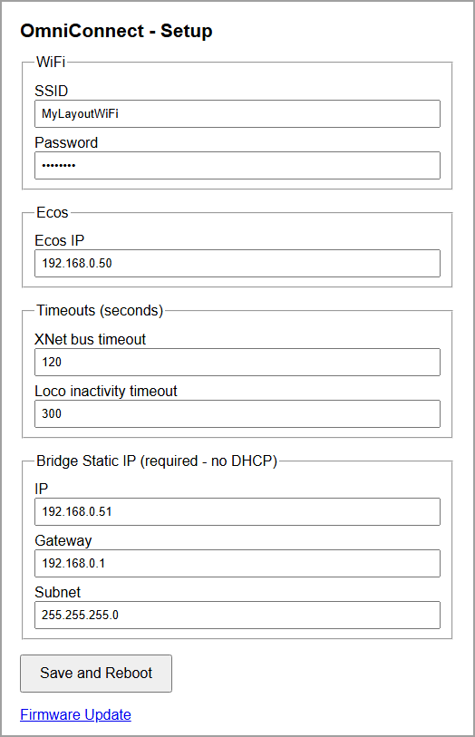
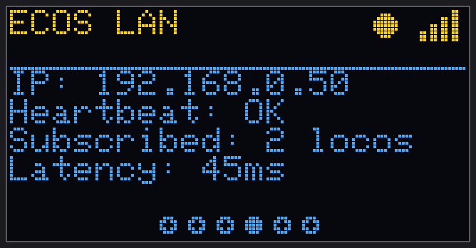

# Quick Start

OmniConnect joins your XpressNet throttles (such as the Roco MultiMaus), Z21 LAN throttles and apps (such as the WLANmaus), and LocoNet throttles (such as the Digitrax UT6) to your **ESU ECoS**. Change anything on any throttle and every other throttle and the ECoS follow. The ECoS stays your command station.

## What you need

- the OmniConnect unit and its 15 V DC power supply (13.6 V minimum)
- your ECoS, on the same home network as OmniConnect, and its IP address
- your Wi-Fi network name and password (2.4 GHz)
- one **free fixed IP address** on your network for OmniConnect (outside your router's automatic range), plus your router's address (gateway) and the subnet mask
- a phone or computer with Wi-Fi, to do the one-time setup

## 1. Connect

1. Plug your **XpressNet** throttles into the XpressNet socket(s). OmniConnect is the XpressNet master - never connect another command station or Z21 to the same XpressNet cable.
2. Plug your **LocoNet** throttle into the LocoNet socket.
3. Z21 throttles and apps need no cable: they join your Wi-Fi network (see step 4).
4. Connect the power supply last.

> **Note** Wiring details for builders are in the OmniConnect Assembly and Connection Guide.

## 2. First-time setup (about 5 minutes)

A new unit has no settings, so it starts its own Wi-Fi network for setup.

1. On your phone or computer, join the Wi-Fi network **OmniConnect-Setup** (no password).
2. Open a browser and go to **http://192.168.4.1**
3. Fill in the form, then press **Save and Reboot**.

{w=6.2}

| Field | What to enter |
|---|---|
| SSID / Password | Your home Wi-Fi network name and password |
| Ecos IP | The IP address of your ECoS |
| IP / Gateway / Subnet | A free fixed address for OmniConnect, your router's address, and the subnet (normally 255.255.255.0) |
| Timeouts | Leave at 120 and 300 seconds unless you have a reason to change them |

OmniConnect saves the settings and restarts into normal operation. To change them later, **hold the Setup button for 3 seconds** (top left corner of the unit, seen from the front); OmniConnect restarts into the Setup page again.

## 3. Check it is running

After a 10 second logo, the small display shows a new page every 5 seconds. Look at the **ECOS LAN** page: a filled circle in the top corner and **Heartbeat: OK** mean OmniConnect is talking to your ECoS.

{w=8.5}

## 4. Drive

- **XpressNet (MultiMaus):** select a locomotive and drive as usual. After an OmniConnect restart, unplug and replug the throttle if it shows an error.
- **Z21 (WLANmaus or app):** set the Z21 address in the throttle to the **fixed IP address you gave OmniConnect** (port 21105 is the standard Z21 port).
- **LocoNet (UT6):** select the locomotive address as usual.

Speed, direction, functions, track power / STOP and turnouts now follow between every throttle and the ECoS.

## If something is not right

| You see | Try |
|---|---|
| Cannot find **OmniConnect-Setup** | Hold the Setup button for 3 seconds and wait about 30 seconds |
| **Heartbeat: NO** on the ECOS LAN page | Check the Ecos IP in Setup and that the ECoS is on the same network |
| MultiMaus shows an error | Unplug it, wait a few seconds, plug it back in |
| Z21 app cannot connect | Use the fixed IP address you set for OmniConnect |

The **User Manual** has the full list, with every display page explained.
