# 1. Introduction

OmniConnect is a bridge for model railways. It connects the throttles you already own to your **ESU ECoS** command station, whatever system they speak:

- **XpressNet** throttles, such as the Roco MultiMaus, on a wired connection
- **Z21 LAN** throttles and apps, such as the WLANmaus and the Z21 app, over Wi-Fi
- **LocoNet** throttles, such as the Digitrax UT6, on a wired connection
- the **ESU ECoS**, over your home network

OmniConnect works on one simple rule: **a change made on any one of these is mirrored to all the others.** Turn on a headlight on the MultiMaus and it comes on at the ECoS, on the WLANmaus and on the UT6. Turn a turnout on the ECoS and the throttles follow. The ECoS stays the command station and the final authority: it generates the track signal, and OmniConnect never replaces it.

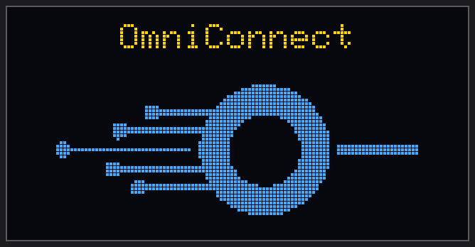{w=8.5}

## 1.1 What it does

| Function | Supported |
|---|---|
| Locomotive speed and direction | Yes, all throttles and the ECoS |
| Locomotive functions F0 to F28 | Yes |
| Track power and emergency STOP / GO | Yes, from any throttle or the ECoS |
| Turnouts (accessories) | Yes |
| Several throttles on one locomotive | Yes, they all stay in step |
| CV and decoder programming | **No** - use the ECoS programming track |

## 1.2 What you need

- an OmniConnect unit with a **15 V DC** power supply (it needs at least 13.6 V; the unit tolerates up to 24 V, but 15 V is recommended)
- an ESU ECoS connected to your home network
- a Wi-Fi network (2.4 GHz) - OmniConnect uses it to reach the ECoS and to serve Z21 throttles
- your throttles
- for setup, a phone or computer with Wi-Fi and a web browser

## 1.3 About this manual

Chapter 2 explains how OmniConnect behaves, so you know what to expect. Chapters 3 to 5 cover connecting, first-time setup and the display. Chapter 6 is about using each kind of throttle, chapter 7 about maintenance, chapter 8 lists the known limits, and chapter 9 is the troubleshooting section. A one-page **Quick Start Guide** and a builder's **Assembly and Connection Guide** are separate documents.

<!-- pagebreak -->

# 2. How OmniConnect works

## 2.1 The mirror rule

Every change flows in two steps. A change made on a throttle goes to the ECoS **and** straight on to every other throttle. A change made on the ECoS itself, with its own knob or screen, goes to every throttle. You do not have to do anything to keep them in step.

The ECoS is the DCC interface and the source of truth. If it is switched off or unplugged, OmniConnect keeps your throttles working with each other, and sends the latest speed, direction and function changes to the ECoS when it comes back.

## 2.2 Locomotives

- OmniConnect tracks up to 50 locomotives at a time.
- A locomotive is picked up the moment any throttle **selects** or **drives** it.
- After **300 seconds** (5 minutes) without any activity, a locomotive is forgotten and OmniConnect stops following it at the ECoS. Driving it again picks it up straight away. You can change this time in Setup.
- Speed is handled in 128 steps on every system. OmniConnect tells XpressNet throttles to use 128 steps, so a MultiMaus that normally uses 28 steps switches by itself.

## 2.3 Track power and STOP

Pressing STOP (or switching track power off) on any throttle or on the ECoS stops **every** locomotive and switches the track off at the ECoS. Pressing GO resumes track power, but **locomotives stay stopped**: nothing starts moving by itself, and each throttle must set a speed again. This is deliberate and matches how real command stations behave.

## 2.4 When a throttle shows "stolen"

If two throttles control the same locomotive, a throttle that did not make the latest change may flash a "stolen" or "in use elsewhere" symbol while it updates its display to match. This is normal and harmless. You can take control back by simply driving the locomotive.

## 2.5 Turnouts

Throw a turnout on any throttle or on the ECoS and every other throttle that can show turnouts follows, and the ECoS drives it. The **turnout number is the ECoS accessory address**: turnout 5 on a throttle is accessory 5 on the ECoS.

<!-- pagebreak -->

# 3. Connecting OmniConnect

> **Important** OmniConnect is the **XpressNet master**. Never connect it to an XpressNet cable that already has another command station or Z21 on it. Two masters on one cable stop everything working.

| Connection | How |
|---|---|
| Power | The 15 V DC power supply (minimum 13.6 V). Connect it last, after the throttles. |
| XpressNet | The socket marked **Xnet**. A MultiMaus or other XpressNet throttle plugs in here. OmniConnect also powers them. |
| LocoNet | The socket marked **LNet-T**. A Digitrax throttle such as the UT6 plugs in here. |
| ECoS | Over your home network, using Wi-Fi. No cable. |
| Z21 throttles and apps | Over your home network, using Wi-Fi. No cable. |

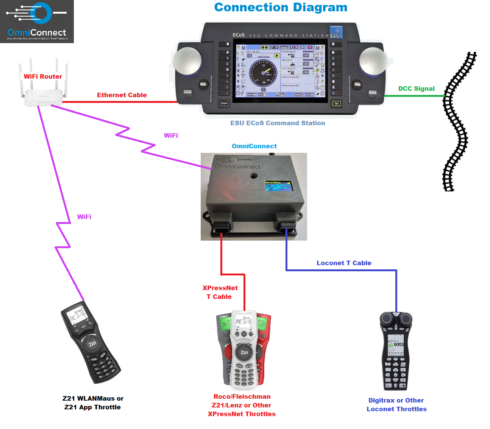{w=13}

> **Important** OmniConnect is the **master** on both sockets, and they are for **throttles only**: never connect a command station, a Z21 or a booster to either. They carry no DCC signal and do **not** support boosters, and nothing that drives the track may be connected to them. The track signal always comes from the ECoS.

Wiring details, pin-outs and building instructions are in the **Assembly and Connection Guide**.

# 4. First-time setup

OmniConnect needs to know your Wi-Fi network, where the ECoS is, and a fixed address of its own. You enter these once on a setup page that OmniConnect serves itself.

## 4.1 When the setup page appears

OmniConnect starts in **Setup Mode** in any of these cases:

- the first time it is switched on (it has no settings yet)
- the stored settings are incomplete
- you **hold the Setup button for 3 seconds** while it is running (top left corner of the unit, seen from the front with the XpressNet socket on the left and the LocoNet-T socket on the right)
- it has not been able to join your Wi-Fi network for **5 minutes** in a row (for example, after you changed your router password), so you can never be locked out

In Setup Mode OmniConnect makes its own Wi-Fi network and does **not** control any locomotives.

## 4.2 Opening the setup page

1. On your phone or computer, open the Wi-Fi settings and join the network named **OmniConnect-Setup**. It has no password.
2. Open a web browser and go to **http://192.168.4.1**
3. The setup page appears.

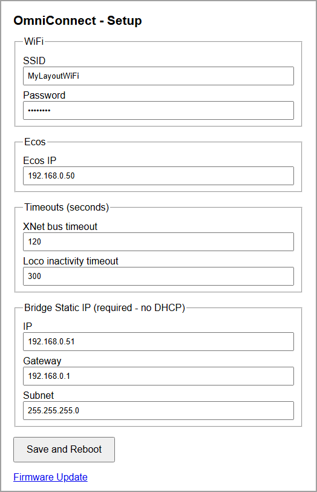{w=6.8}

## 4.3 The settings

| Setting | Meaning | Typical value |
|---|---|---|
| SSID | The name of your home Wi-Fi network (2.4 GHz). | |
| Password | The Wi-Fi password. Leave empty for an open network. | |
| Ecos IP | The IP address of your ECoS. Find it in the ECoS network settings. | 192.168.0.50 |
| XNet bus timeout | How many seconds of silence on the XpressNet cable before OmniConnect reports XpressNet as disconnected. | 120 |
| Loco inactivity timeout | How many seconds a locomotive can be idle before OmniConnect forgets it. | 300 |
| IP | The fixed address OmniConnect will use on your network. It must be unused and outside your router's automatic (DHCP) range. | 192.168.0.51 |
| Gateway | Your router's address. | 192.168.0.1 |
| Subnet | The subnet mask. | 255.255.255.0 |

> **Tip** Write the fixed IP address on the unit. Your Z21 throttles will need it, and you will want to find OmniConnect on your network later.

> **Note** OmniConnect always uses a fixed address and never asks the router for one. This is what lets Z21 throttles find it reliably.

## 4.4 Saving

Press **Save and Reboot**. OmniConnect checks the values, saves them, shows a short confirmation and restarts into normal operation. If a value is not valid the page asks you to go back and correct it.

{w=6.8}

The settings are kept when the power is switched off.

<!-- pagebreak -->

# 5. The display

OmniConnect has a small colour display (yellow band at the top, blue below). It starts with a logo, then shows six information pages in turn. This chapter explains what every line means. The pictures are illustrations of the real display layout.

## 5.1 Start-up

For about **10 seconds** after power-on the display shows the OmniConnect logo while the unit connects in the background.

{w=8.5}

## 5.2 The pages

After the logo, the display changes page **every 5 seconds**, in a loop. Six small dots along the bottom show which page you are on; the filled dot is the current page.

### Icons at the top of every page

- **Wi-Fi bars** (top right corner): four bars means a strong signal, one bar a weak one, none means no usable signal. Move OmniConnect or your router closer if it stays low.
- **Connection symbol** (just left of the Wi-Fi bars, on the interface pages only):

| Symbol | Meaning |
|---|---|
| Filled circle | Connected |
| Open circle | Connecting |
| Cross (X) | Not connected |
| Triangle | Error |

### Page 1 - Main (OmniConnect)

The overview of what is happening right now.

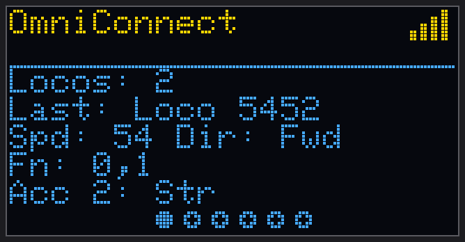{w=8.5}

| Line | Meaning |
|---|---|
| Locos | How many locomotives OmniConnect is following |
| Last | The locomotive of the most recent command |
| Spd / Dir | Its speed (0 to 126) and direction |
| Fn | Its functions that are on, for example 0,1 means F0 and F1 |
| Acc | The most recent turnout command and its position (Str = straight, Div = diverging) |

### Page 2 - Device Status

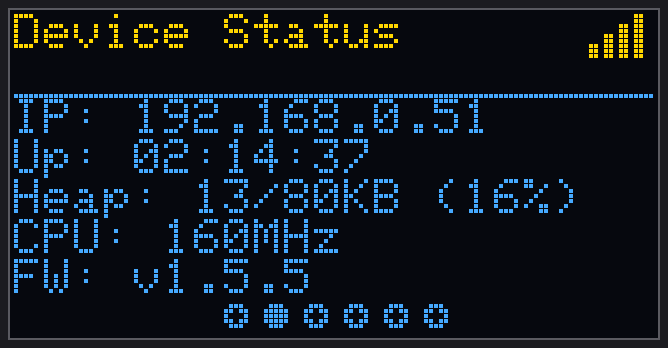{w=8.5}

| Line | Meaning |
|---|---|
| IP | OmniConnect's address on your network |
| Up | How long it has been running (hours:minutes:seconds) |
| Heap | Free memory |
| CPU | Processor speed |
| FW | **Firmware version** - quote this when asking for help |

### Page 3 - XpressNet

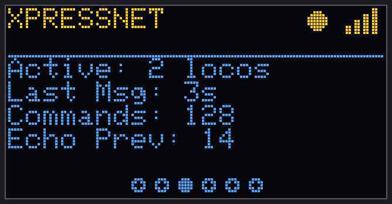{w=8.5}

| Line | Meaning |
|---|---|
| Active | Locomotives active on XpressNet |
| Last Msg | Seconds since an XpressNet throttle last sent anything |
| Commands | Total commands handled since power-on |
| Echo Prev | Echoes OmniConnect held back so a throttle is not sent its own command again |

### Page 4 - ECoS LAN

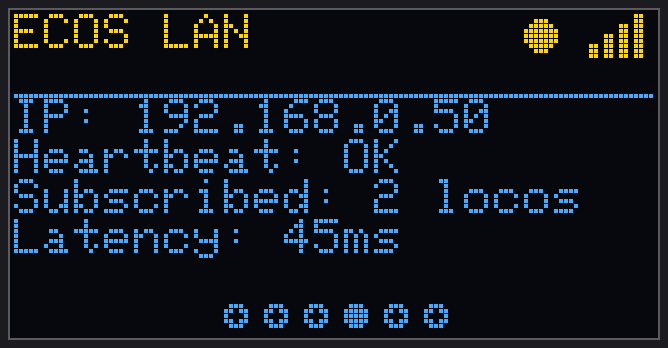{w=8.5}

| Line | Meaning |
|---|---|
| IP | The ECoS address you entered in Setup |
| Heartbeat | OK when the ECoS is answering, NO when it is not |
| Subscribed | Locomotives being followed on the ECoS |
| Latency | How long the ECoS takes to answer, in milliseconds |

### Page 5 - Z21 LAN

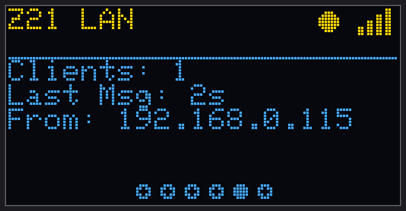{w=8.5}

| Line | Meaning |
|---|---|
| Clients | Z21 throttles and apps currently connected |
| Last Msg | Seconds since the last real action (drive, function, STOP, turnout) |
| From | Address of the device that sent it |

### Page 6 - LocoNet

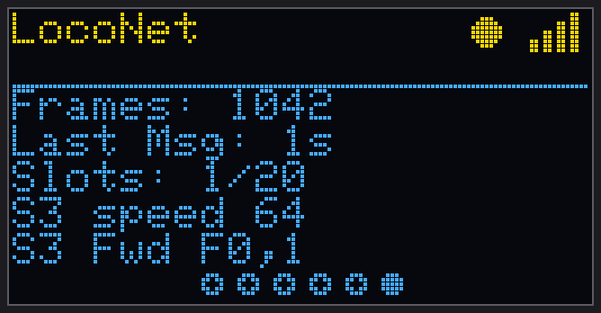{w=8.5}

| Line | Meaning |
|---|---|
| Frames | LocoNet messages received (Err appears beside it only if some were damaged) |
| Last Msg | Seconds since the last LocoNet message |
| Slots | LocoNet locomotive slots in use, out of 20. The connection symbol is filled while a throttle is holding a slot. |
| Bottom two lines | The last two messages in plain words, for example "S3 speed 64" |

## 5.3 Warnings

If free memory falls very low the Device status page adds **!WARNING: Low memory** at the bottom. OmniConnect keeps running; see chapter 9.

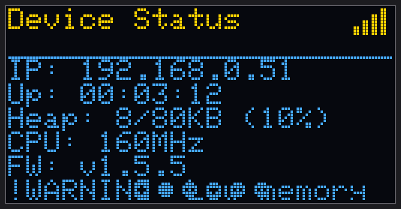{w=8.5}

<!-- pagebreak -->

# 6. Using your throttles

In every case, use the throttle the way its own manual describes. The notes below only cover what is specific to OmniConnect.

## 6.1 XpressNet throttles (for example Roco MultiMaus)

- Select a locomotive and drive normally. OmniConnect answers the throttle immediately and tells it to use 128 speed steps.
- Changes made elsewhere appear on the throttle's display. You may see its "stolen" symbol flash while it updates; this is normal.
- A MultiMaus has no speed display, so changes of speed made elsewhere are not shown on it.
- **After OmniConnect restarts**, a MultiMaus can show an error for a while. Unplug it, wait a few seconds and plug it back in; it attaches at once.
- Turnouts: use the throttle's turnout screen. The number you enter is the ECoS accessory address.
- The XpressNet status stays connected through quiet periods. A throttle that is idle can legitimately say nothing for a long time.

## 6.2 Z21 LAN throttles and apps (for example WLANmaus)

- In the throttle or app, set the **Z21 address** to the fixed IP address you gave OmniConnect in Setup. The standard Z21 port (21105) is used automatically.
- Throttles join and leave on their own; the Z21 page shows how many are connected.
- Drive, functions, STOP/GO and turnouts all work and mirror to the other systems.
- A throttle running low on battery can behave erratically; try fresh batteries before suspecting anything else.
- A WLANmaus turnout display may occasionally lag behind a change made elsewhere. The turnout itself, and the ECoS, are always correct.

## 6.3 LocoNet throttles (for example Digitrax UT6)

- OmniConnect acts as the LocoNet command station for locomotive control. Select the locomotive address as usual; there is no "steal this locomotive?" question.
- Speed, direction, functions F0 to F28, track power and STOP all mirror.
- **Display refresh:** a UT6 does not normally show changes made elsewhere. OmniConnect makes it refresh by briefly interrupting the LocoNet signal, about a quarter of a second, a few seconds after a change. The UT6 screen flashes once and then shows the new values, and you keep the locomotive. This is normal.
- The UT6 shows speed as a percentage (0 to 99), not as the 0 to 126 shown elsewhere.
- OmniConnect releases a LocoNet slot if the throttle has been silent for 10 minutes, so the LocoNet page shows the true number of throttles in use. Driving again takes it back.
- **Turnouts:** you can throw turnouts from a UT6 and they mirror to everything else. The UT6 does not redraw a turnout's position when it is changed elsewhere; it shows the position after you press its function key. Pressing it sends the command again, which is harmless.

## 6.4 The ECoS

- Use the ECoS exactly as before: its knob, screens, and apps keep working and everything else follows.
- Functions F8 to F11 are inverted on the ECoS, so OmniConnect flips them for you; throttles and the ECoS agree on what is on and what is off.
- The ECoS starts up with track power off; OmniConnect learns this when it connects, and shows the track state correctly on throttles that have a power indication.

<!-- pagebreak -->

# 7. Maintenance

## 7.1 Changing the settings

Hold the **Setup button for 3 seconds**. The button is on the top left corner of the unit when you face it with the XpressNet socket at the front left and the LocoNet-T socket at the front right. OmniConnect restarts into Setup Mode (chapter 4). Change what you need and press **Save and Reboot**. Nothing is lost: the existing values are shown filled in.

## 7.2 Updating the firmware

1. Put OmniConnect into Setup Mode (hold the Setup button for 3 seconds) and join its Wi-Fi network as in chapter 4.
2. In the browser, go to **http://192.168.4.1/update**, or press the **Firmware Update** link at the bottom of the setup page.
3. The page shows the version and build currently installed.
4. Choose the new firmware file (a file ending in **.bin**) and press **Upload and Flash**.
5. Wait until OmniConnect restarts by itself. **Do not switch it off while it is updating.**
6. Check the new version on page 2 of the display (the FW line).

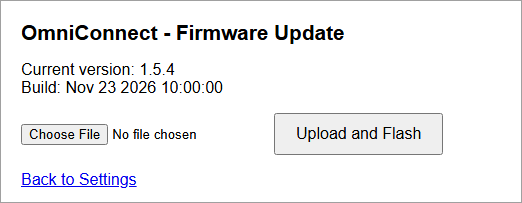{w=6.8}

> **Important** Only use firmware files supplied for OmniConnect. A damaged or interrupted update does not harm the unit: the old version keeps running, and you can simply try again.

## 7.3 Switching off and restarting

OmniConnect can be switched off at any time. When it starts again it picks up locomotives as throttles select them. After a restart:

- XpressNet throttles may need to be unplugged and replugged once
- the ECoS reconnects by itself within a few seconds
- Z21 and LocoNet throttles reconnect by themselves

<!-- pagebreak -->

# 8. Known limits

- **No programming.** CVs and decoder settings are not available through OmniConnect. Use the ECoS programming track.
- **One command station.** OmniConnect works only with the ESU ECoS. The ECoS is required.
- **Wi-Fi.** OmniConnect uses 2.4 GHz Wi-Fi and needs a fixed address.
- **Sizes.** Up to 50 locomotives at a time, 20 LocoNet slots.
- **Throttle displays.** A MultiMaus has no speed display. A UT6 shows speed as 0 to 99 and does not redraw turnout positions changed elsewhere. A WLANmaus turnout display can lag.
- **Quick repeated presses.** A throttle can only send one message at a time, so pressing a function key many times very quickly can merge presses. The ECoS always receives what the throttle actually sent.

<!-- pagebreak -->

# 9. Troubleshooting

Work down the list. If a problem remains, note the firmware version (page 2 of the display) and what each page shows when you ask for help.

## 9.1 Display and start-up

| Symptom | Likely cause | What to do |
|---|---|---|
| Display stays blank | No power, or display loose | Check the power supply and switch. If the unit is on but the display is dark, ask the builder to check the display connection. |
| Stuck on the logo for more than 15 seconds | Start-up problem | Switch off, wait 10 seconds, switch on again. |
| Wi-Fi bars empty or low | Weak signal | Move OmniConnect or the router closer, or add an access point. |
| !WARNING: Low memory | Memory is very low | Switch OmniConnect off and on. If the warning returns quickly, tell the supplier. |

## 9.2 Setup

| Symptom | Likely cause | What to do |
|---|---|---|
| **OmniConnect-Setup** network does not appear | OmniConnect is not in Setup Mode | Hold the Setup button for 3 seconds. Wait about 30 seconds and refresh your Wi-Fi list. |
| Setup page does not open | Phone is using mobile data, or a different Wi-Fi | Join OmniConnect-Setup, turn off mobile data, and open **http://192.168.4.1** (type the address, not a search). |
| Page asks you to go back and correct a value | An address or number is not valid | Check each address has four numbers (for example 192.168.0.51) and the timeouts are between 1 and 3600. |
| After saving, OmniConnect does not join the network | Wrong Wi-Fi name or password, or the 5 GHz band | Re-enter Setup and check the SSID and password. Use a 2.4 GHz network. After 5 minutes of failing, OmniConnect returns to Setup Mode by itself. |
| Cannot reach OmniConnect afterwards | Fixed address clashes with another device, or is outside your network | Choose an unused address on your network's subnet. |

## 9.3 The ECoS

| Symptom | Likely cause | What to do |
|---|---|---|
| ECOS LAN page: **Heartbeat: NO**, cross symbol | The ECoS is off, unplugged, or at a different address | Check the ECoS is on and on the same network. Check the Ecos IP in Setup. |
| Throttle changes do not reach the ECoS but throttles still follow each other | The ECoS has gone away | Fix the ECoS connection; OmniConnect sends the latest changes when it returns. |
| Locomotive does not respond at the ECoS | The locomotive is not in the ECoS list, or at a different address | Add the locomotive to the ECoS with the address you are driving. |

## 9.4 XpressNet throttles

| Symptom | Likely cause | What to do |
|---|---|---|
| Throttle shows an error right after OmniConnect restarts | It has not attached yet | Unplug it, wait a few seconds, plug it in again. |
| Throttle shows an error and never attaches | Another master on the same cable, a bad cable, or a loose connector | Make sure nothing else is a master on that cable; check the cable and connectors. |
| XpressNet page shows a cross symbol | No XpressNet message for the bus timeout | Move a throttle: any command wakes it. Check cables. |
| A function press sometimes does nothing | Presses were too quick, or a battery is low | Press once and wait a moment. |
| Another throttle's changes do not show | The throttle is not on the same locomotive | Select the same locomotive address on both. |

## 9.5 Z21 throttles and apps

| Symptom | Likely cause | What to do |
|---|---|---|
| Cannot connect | Wrong address, or on a different Wi-Fi | Use OmniConnect's fixed IP address as the Z21 address and be on the same network. |
| Z21 page shows 0 clients | Nothing connected yet | Connect the throttle; the page updates within seconds. |
| Throttle behaves erratically | Low battery | Fit fresh batteries. |

## 9.6 LocoNet throttles

| Symptom | Likely cause | What to do |
|---|---|---|
| UT6 does not power up or shows nothing | LocoNet not connected | Check the LocoNet cable, and the power to OmniConnect. |
| UT6 shows no track-power icon | The ECoS state is not known yet | Wait a few seconds, or toggle STOP / GO. |
| UT6 screen flashes a few seconds after a change made elsewhere | Normal: it is refreshing | No action. |
| UT6 turnout shows the old position | The UT6 does not redraw turnouts | Press its function key; it sends the command again. |
| LocoNet page shows slots in use after the throttle is gone | The 10-minute timeout has not passed yet | Wait, or reselect a locomotive. |

## 9.7 Everything behaves strangely

1. Check the power supply is connected firmly.
2. Check page 2 of the display: Heap should be at least 10 KB.
3. Switch OmniConnect off, wait 10 seconds, switch on.
4. Re-enter Setup (hold the Setup button for 3 seconds) and check every value.

<!-- pagebreak -->

# Appendix A. Specifications

| | |
|---|---|
| Firmware version | shown on page 2 of the display |
| Power | 15 V DC recommended (13.6 V minimum, 24 V maximum) |
| Wi-Fi | 2.4 GHz, with a fixed IP address |
| Z21 LAN | UDP port 21105 |
| ECoS | TCP port 15471 |
| Setup network | **OmniConnect-Setup** (open), page at **http://192.168.4.1** |
| Setup button | Hold 3 seconds |
| Locomotives | Up to 50 at a time, functions F0 to F28 |
| LocoNet | 20 slots |

# Appendix B. Glossary

| Term | Meaning |
|---|---|
| ECoS | The ESU command station |
| XpressNet | Lenz / Roco wired throttle bus, used by the MultiMaus |
| Z21 LAN | The Roco Z21 network protocol, used by the WLANmaus and the Z21 app |
| LocoNet | Digitrax wired throttle bus, used by the UT6 |
| Master | The unit that runs a bus and talks to every throttle on it |
| Slot (LocoNet) | A place in the command station that holds one locomotive for a throttle |
| Stolen | A throttle symbol meaning another controller changed its locomotive |
| Setup Mode | OmniConnect's own Wi-Fi network and settings page |
| Heartbeat | OmniConnect's regular check that the ECoS is answering |
